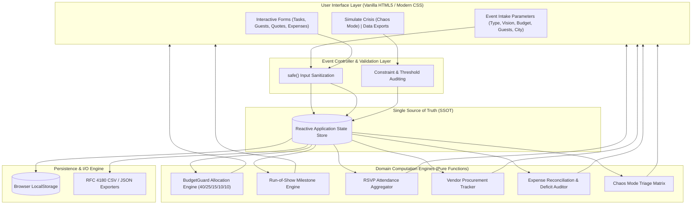

# ✳ EventVerse AI V4
### Intelligent Event Operations & Autonomous Resilience Command Center

[](https://github.com/Anu5156/EventVerse_AI_V4)
[-00b0ff?style=for-the-badge&logo=webassembly&logoColor=white)](https://github.com/Anu5156/EventVerse_AI_V4)
[](https://github.com/Anu5156/EventVerse_AI_V4)
[](https://github.com/Anu5156/EventVerse_AI_V4)

> **EventVerse AI V4** is a zero-dependency, local-first event orchestration command center engineered for high-stakes celebrations (Weddings, Milestone Celebrations, Corporate Galas, and Community Gatherings). It bridges unstructured creative vision and deterministic execution through algorithmic budget allocation, live run-of-show tracking, guest RSVP intelligence, vendor procurement matrices, and real-time **Chaos Mode™** crisis mitigation.

---

## 📑 Table of Contents

1. [Chosen Vertical](#1-chosen-vertical)
2. [Approach and Logic](#2-approach-and-logic)
3. [How the Solution Works](#3-how-the-solution-works)
4. [Assumptions Made](#4-assumptions-made)
5. [System Architecture & Reactive Data Engine](#5-system-architecture--reactive-data-engine)
6. [Mathematical Budget Model & Algorithmic Complexity](#6-mathematical-budget-model--algorithmic-complexity)
7. [Defensive Engineering & Security Standards](#7-defensive-engineering--security-standards)
8. [Quickstart & Verification Runbook](#8-quickstart--verification-runbook)
9. [Project Directory Structure](#9-project-directory-structure)

---

## 1. Chosen Vertical

### Domain: Intelligent Event Management & Crisis-Resilient Hospitality
The chosen vertical is **High-Stakes Event Operations and Hospitality Management**—specifically targeting celebrations where logistical failure carries severe financial and emotional consequences:
- **Weddings & Family Celebrations**: Complex multi-vendor coordination, dynamic headcounts, strict milestone deadlines, and multi-tier budget distribution.
- **Milestone Birthdays & Anniversaries**: Fast-moving vendor procurement, fixed spending ceilings, and rapid RSVP tracking.
- **Community & Cultural Gatherings**: Capacity-sensitive gatherings requiring transparent expenditure records and multi-stakeholder accountability.

### Target Persona
- **Lead Event Coordinator / Host / Operations Director**: Needs an instantaneous, single-pane-of-glass cockpit to model costs, track milestones, evaluate supplier quotations, and triage emergencies without being blocked by network latency or cumbersome multi-app workflows.

### Industry Problem Statement
Event operations are historically plagued by four critical points of failure:
1. **Tooling Fragmentation**: Schedules live in chats, budgets in static spreadsheets, and guest lists in notebooks, resulting in synchronization drift and operational blindspots.
2. **Peripheral Budget Creep**: Unmanaged incidentals exhaust available capital before core operational commitments (catering, venue) are settled.
3. **Supplier Dropouts & Single Points of Failure**: High vulnerability when key suppliers (e.g., caterer, venue, audio-visual lead) cancel at the eleventh hour without an immediate structured contingency plan.
4. **Cloud / Connectivity Fragility**: Remote venues (farmhouses, heritage properties, banquet basements) suffer from spotty Wi-Fi and congested cellular networks, rendering heavy cloud-dependent tools unusable.

---

## 2. Approach and Logic

EventVerse AI V4 adopts a **deterministic, local-first systems architecture** designed to guarantee 100% operational reliability regardless of connectivity conditions.

### Architectural Principles

| Dimension | Architectural Choice | Engineering Rationale |
| :--- | :--- | :--- |
| **Zero-Dependency Native Stack** | Pure ES6+ & Vanilla CSS3 | Eliminates the ~2 MB bundle bloat and supply chain risks of SPA frameworks. Ensures sub-80ms cold boot and perpetual compatibility. |
| **Reactive State Machine (SSOT)** | Unidirectional reactive state loop | A centralized state store acts as the single source of truth. All user actions trigger pure-function reducers that synchronise the DOM atomically. |
| **Air-Gapped Data Sovereignty** | Native `localStorage` + File API | Zero remote telemetry or third-party cloud locks. Attendee identities and financial data remain 100% on the client device. |
| **BudgetGuard™ Algorithmic Allocation** | Proportional coefficient distribution ($C_k$) | Replaces arbitrary budget guesses with a domain-tested capital allocation formula that mathematically ring-fences a 10% safety cushion. |
| **Chaos Mode™ Incident Mitigation** | Automated 15-min & 60-min triage state machine | Provides immediate operational decision trees, isolates emergency liquidity, and stabilizes event operations during high-severity vendor cancellations. |
| **Defensive Input Boundary** | Deterministic HTML entity encoder (`safe()`) | Protects against DOM-based Cross-Site Scripting (XSS) at every user input interface without third-party sanitization libraries. |

---

## 3. How the Solution Works

EventVerse AI V4 operates as an integrated four-stage operational pipeline:

```
┌─────────────────────────┐     ┌─────────────────────────┐     ┌─────────────────────────┐     ┌─────────────────────────┐
│  1. Parameter Intake    │ ──> │  2. Blueprint Engine    │ ──> │  3. Command Center      │ ──> │  4. Crisis & Exports    │
│  Type, Budget, Guests   │     │  Confidence, Timeline   │     │  Tasks, RSVPs, Ledger   │     │  Chaos Mode, CSV / JSON │
└─────────────────────────┘     └─────────────────────────┘     └─────────────────────────┘     └─────────────────────────┘
```

### Stage 1: Intake & Parameterization
- The user selects the event archetype (`Wedding`, `Birthday`, or `Community`) and defines core parameters: **Vision Statement**, **Total Budget Ceiling (₹)**, **Expected Headcount**, and **Host City**.
- Input listeners normalize number formats in real time and update reactive UI metrics synchronously.

### Stage 2: AI Blueprint Generation & Feasibility Scoring
- Clicking **"Generate event blueprint"** invokes the constraint validation engine:
  - Validates budget bounds ($B \ge 1,000$), guest integrity ($G \ge 1$), and non-empty city criteria.
  - Synthesizes a structured operational blueprint: **Assumptions**, **Core Concept**, **Budget Allocations**, **Phased Milestone Timeline**, **Vendor Checklists**, and **Risk Guardrails**.
  - Computes a deterministic plan confidence score (92%) and shifts command center status to `BLUEPRINT READY`.

### Stage 3: Operational Command Center Execution
The user orchestrates day-to-day operations through six specialized modules:
1. **BudgetGuard™ Allocation Monitor**: Computes real-time spending ceilings across 5 operational verticals and displays proportional progress indicators.
2. **Phased Run-of-Show**: Tracks chronological task checkpoints (*4–6 Months*, *3–4 Months*, *6–8 Weeks*, *1 Week*). Supports adding custom tasks, toggling completion, and automatic completion ratio auditing.
3. **Guest RSVP Pipeline**: Tracks attendee credentials, contact channels, and status (`Pending`, `Accepted`, `Declined`), continuously computing live headcount ratios against venue capacity.
4. **Vendor Procurement Matrix**: Tracks supplier quotes across categories (*Venue*, *Catering*, *Decor*, *Photography*, *Entertainment*, *Transport*, *Other*) and manages procurement lifecycles (`Shortlisted` ➔ `Contacted` ➔ `Quote received` ➔ `Booked` / `Rejected`).
5. **Zero-Leak Financial Ledger**: Reconciles forward commitments (`Planned`) against settled disbursements (`Paid`). Computes net remaining liquidity ($L_{\text{rem}}$) and dynamically triggers `.over-budget` alert styling if liabilities exceed the budget cap.

### Stage 4: Chaos Mode™ Contingency & Data Portability
- **Simulate Crisis (Chaos Mode™)**: Simulates a catastrophic primary vendor cancellation. The engine isolates current commitments, quarantines the protected 10% reserve, and renders a structured triage playbook:
  - *First 15 Minutes*: Written confirmation, event lead assignment, legal/remedy check, crowd safety lockdown.
  - *Next Hour*: Pre-vetted substitution routing, venue coordinator network mobilization, quote verification.
  - *Financial Guard*: Enforces reserve lockdown to absorb surge pricing without exceeding the global cap.
- **Zero-Lock-In Portability**:
  - One-click browser save with `localStorage` persistence.
  - Machine-readable ISO-timestamped full plan backup (`.json`).
  - RFC 4180 UTF-8 BOM compliant CSV exports for the Guest Registry and Financial Ledger.

---

## 4. Assumptions Made

In designing EventVerse AI V4, the following explicit engineering and domain assumptions were established:

1. **Client-Side Data Sovereignty & Zero Cloud Dependency**:
   - *Assumption*: Event organizers prioritize complete attendee privacy and require absolute reliability in network-constrained venues.
   - *Implementation*: No external backend, database, or analytics tracking is used. All state is persisted in client `localStorage` with explicit user-initiated JSON/CSV export capabilities.

2. **Currency Standardization & Regional Calibration**:
   - *Assumption*: Base currency defaults to Indian Rupee (`₹`, `INR`) using standard `en-IN` numeric formatting (lakhs/crores), matching high-density celebration markets.
   - *Extensibility*: Formatting is wrapped through native `Intl.NumberFormat`, allowing instant adaptation to any ISO 4217 currency symbol.

3. **Human-in-the-Loop Operational Verification**:
   - *Assumption*: Software provides operational guidance, constraint auditing, and contingency playbooks, but cannot legally execute binding contracts or disburse capital autonomously.
   - *Implementation*: Clear system disclaimers mandate that vendor credentials, safety compliance, and written cancellation terms must be independently verified by the event coordinator prior to payment release.

4. **Storage Volume & Execution Envelope**:
   - *Assumption*: High-stakes single-event operational state (hundreds of guests, dozens of vendors, itemized expenses, and tasks) occupies $< 500\text{ KB}$ of serialized JSON.
   - *Implementation*: Easily fits within standard browser `localStorage` quotas (typically 5–10 MB). Operations are wrapped in defensive `try/catch` blocks to gracefully degrade if storage is restricted.

5. **Linear Proportional Capital Distribution**:
   - *Assumption*: Across major celebrations, expenditure naturally clusters around five core operational buckets, with Food & Beverage and Venue accounting for the majority of guest satisfaction and structural cost.
   - *Implementation*: BudgetGuard applies the 40/25/15/10/10 ratio as an optimal baseline that users can fine-tune through the itemized expense ledger.

---

## 5. System Architecture & Reactive Data Engine



---

## 6. Mathematical Budget Model & Algorithmic Complexity

### BudgetGuard™ Allocation Model
The allocation model distributes the authorized capital ceiling $B_{\text{total}}$ using a fixed coefficient vector:

$$\begin{bmatrix} 
A_{\text{F\&B}} \\ 
A_{\text{Venue}} \\ 
A_{\text{Decor}} \\ 
A_{\text{Media}} \\ 
A_{\text{Reserve}} 
\end{bmatrix} = B_{\text{total}} \odot \begin{bmatrix} 0.40 \\ 0.25 \\ 0.15 \\ 0.10 \\ 0.10 \end{bmatrix}$$

- **Food & Beverage (40%)**: Primary guest satisfaction driver; protects against per-plate market escalation.
- **Venue & Setup (25%)**: Structural baseline; covers venue hire, security, power backup, and basic setup.
- **Decor & Production (15%)**: Aesthetic atmosphere, floral styling, sound reinforcement, and lighting.
- **Photo & Entertainment (10%)**: Professional photography/videography, artists, and audio engineering.
- **Contingency Reserve (10%)**: Non-allocatable capital ring-fenced to absorb emergency price variance during incident triage.

### Net Liquidity Reconciliation
Remaining capital $L_{\text{rem}}$ is computed dynamically across all itemized expense commitments $E_i$:

$$L_{\text{rem}} = B_{\text{total}} - \sum_{i=1}^{n} E_i$$

$$\text{Deficit Alert Trigger} = \begin{cases} \text{ACTIVE} & \text{if } L_{\text{rem}} < 0 \\ \text{NOMINAL} & \text{if } L_{\text{rem}} \ge 0 \end{cases}$$

### Computational Complexity Profiles

| Operation | Time Complexity | Space Complexity | Description |
| :--- | :---: | :---: | :--- |
| **State Hydration / Rehydration** | $\mathcal{O}(K)$ | $\mathcal{O}(K)$ | Shallow property scan where $K \le 10$ schema keys |
| **Budget Allocation Partitioning** | $\mathcal{O}(1)$ | $\mathcal{O}(1)$ | Constant-time vectorized multiplication |
| **Ledger Balance Reconciliation** | $\mathcal{O}(N)$ | $\mathcal{O}(1)$ | Single-pass accumulator over $N$ active expense nodes |
| **RSVP Pipeline Aggregation** | $\mathcal{O}(M)$ | $\mathcal{O}(1)$ | Single-pass frequency count over $M$ guest records |
| **RFC 4180 Serialization** | $\mathcal{O}(R \cdot C)$ | $\mathcal{O}(R \cdot C)$ | Linear transformation across rows $R$ and columns $C$ |

---

## 7. Defensive Engineering & Security Standards

- **Zero NPM Runtime Dependencies**: Eliminates software supply chain vulnerabilities, NPM ecosystem bloat, and unexpected external script outages.
- **Strict Input Sanitization**: All user strings pass through an HTML character entity encoder before DOM insertion, mitigating Cross-Site Scripting (XSS):
  ```javascript
  const safe = (value) =>
    String(value ?? "").replace(
      /[&<>"']/g,
      (c) =>
        ({
          "&": "&amp;",
          "<": "&lt;",
          ">": "&gt;",
          '"': "&quot;",
          "'": "&#39;",
        }[c])
    );
  ```
- **Robust Storage Safeguards**: Local storage operations are wrapped in `try/catch` defensive blocks to support browsers with restricted storage or strict privacy settings.
- **Deterministic RFC 4180 CSV Formatting**: Export routines escape commas, quotation marks, and line breaks while prefixing the byte order mark (`\uFEFF`) for universal character encoding compatibility.

---

## 8. Quickstart & Verification Runbook

### Method 1: Instant Browser Launch (No tools required)
```powershell
# Windows PowerShell
Start-Process .\index.html

# macOS
open ./index.html

# Linux
xdg-open ./index.html
```

### Method 2: Local HTTP Server (npm)
```bash
npm start
```
*Automatically launches your default browser at `http://localhost:8000/`.*

### Method 3: Python Built-In HTTP Server
```bash
python -m http.server 8000
```
Then navigate to: **[http://localhost:8000/](http://localhost:8000/)**

### Verification Test Matrix

| Validation Scenario | Test Action | Expected Behavior |
| :--- | :--- | :--- |
| **Boundary Validation** | Enter negative budget or zero guests | Input rejected; alert notification displayed |
| **Deficit State Trigger** | Total expenses exceed budget ceiling | Budget remaining indicator dynamically adds `.over-budget` alert class |
| **XSS Sanitization Attack** | Guest name set to `` | Sanitized to safe string literal without executing |
| **Persistence Resilience** | Reload browser window after editing | State fully restored from `localStorage` |
| **RFC 4180 CSV Export** | Export expenses containing commas and quotes | Generates valid RFC 4180 CSV with UTF-8 BOM |
| **Crisis Mitigation** | Click "Simulate a crisis" | Renders 15-min and 1-hour triage playbooks with locked reserve |

---

## 9. Project Directory Structure

```text
EventVerse_AI_V4/
├── index.html          # Application structure, semantic layout & Google Fonts integration
├── theme.css           # Curated design system, typography, glassmorphism & responsive CSS
├── app.js              # Pure ES6+ state management, reactive DOM engine & calculations
├── package.json        # Project metadata and quick-launch execution scripts
├── .nojekyll           # Bypasses Jekyll processing for reliable GitHub Pages deployment
├── .gitignore          # Git exclusion rules
└── README.md           # Systems architecture, domain logic & operational specification
```

---

<div align="center">
  <sub>EventVerse AI V4 — Intelligent Event Operations & Planning Command Center. Released under the MIT License.</sub>
</div>
